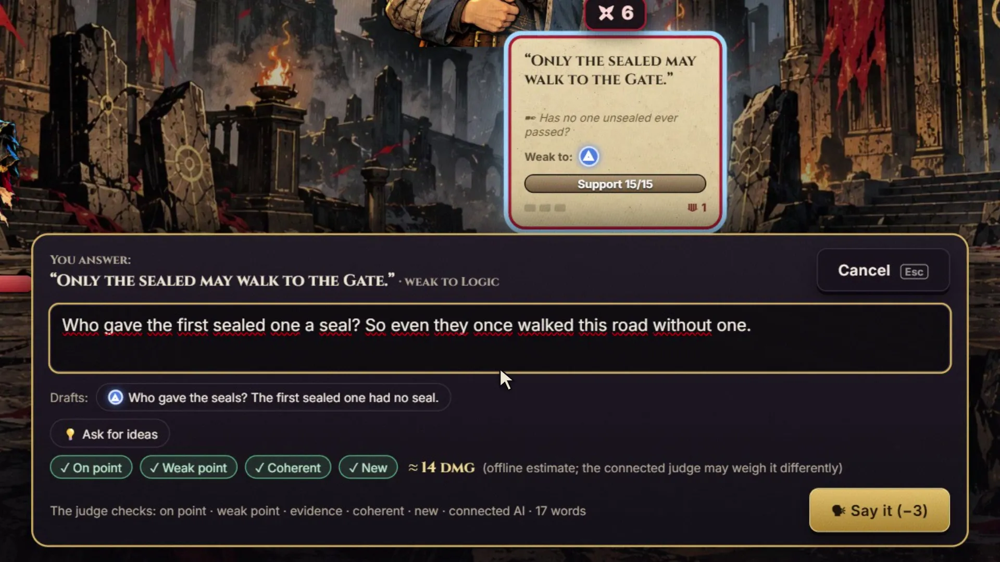
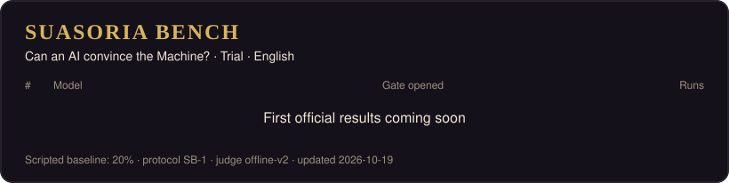

  

<h1 align="center">SUASORIA — Convince the Machine</h1>

  <b>A roguelike deckbuilder where words are the only weapon.</b> 
  Climb the mountain, out-argue everyone who blocks your road, and convince the Warden of Oaths to open the Gate. 
  And a benchmark that asks AI models to do the same: <b>can a machine convince the Machine?</b>

  <b>▶ Play free in your browser: opening soon on ChatGPT Sites</b> ·
  <a href="https://tuncertimur.github.io/suasoria/">Trailer & live leaderboard</a> ·
  <a href="LEADERBOARD.md">Full leaderboard</a> ·
  <a href="README.tr.md">🇹🇷 Türkçe</a>

  

## Why this game exists

This game is a test bench, and the benchmark is the point. I wanted to see what happens when the thing you argue with can actually read you, and when an AI has to win by persuasion instead of by force.

- **For players:** you write your own sentences, and an AI rival answers them in character, quotes you and needles you. The game's rules, not the AI, decide every number. AI makes the duel feel alive without being able to bend the outcome.
- **For AI models:** SUASORIA Bench makes them play the very same game, so you can compare how well each one reasons, plans and persuades under the same rules.
- **For what comes next:** this is my first small experiment in a new kind of game for a changing world. Next I want to build a **multiplayer tabletop RPG in the spirit of Dungeons & Dragons**. In it an AI game master rolls the dice, sets up the campaign by itself, and builds the NPCs and the world from what the players imagine. SUASORIA is the first, simple step toward that.

## The game

A thousand years ago the last sword broke in Suasoria. Since then, only words may wound.

- **You are an advocate.** Seven floors of rivals stand between you and the Gate. Each one puts *claims* on the table: reasons you shall not pass. Topple every claim and they are convinced. Let your Will run out and you are silenced.
- **Cards and your own sentences.** Argument cards strike harder at a claim's weak point. When you have the floor, write your own sentence: your rival quotes it and fires back.
- **Rivals that listen.** Offline, rivals answer with written lines. Connect your own AI and they read what you mean, answer in character and throw jabs between moves. Rules and numbers always stay in the game's engine: the AI cannot cheat, and neither can you.
- **Any AI key works.** OpenAI, OpenRouter (hundreds of models behind one key), NVIDIA, Google Gemini, Anthropic, Groq, DeepSeek, Mistral, xAI, z.ai, Together, Cerebras, Fireworks. No key? Use Ollama or LM Studio on your own computer. Paste a key and the provider's model list opens: search it and pick one. Free models are marked. Your key stays in your browser.
- **The Warden remembers.** Every choice on the road goes into the Ledger of Costs, and at the trial the Warden asks about all of it. Next run it remembers your last Final Word. Open the Gate by all four roads and the Warden goes free.
- Turkish and English · free · runs in the browser.

## SUASORIA Bench

Every model plays the same games: same seeds, same three advocates, same rules, same deterministic judge. One question: **how often does it open the Gate?**

<!-- SUASORIA:BOARD:START -->
### Trial · English

| # | Model | Gate opened | 95% CI | Passage | Silenced | Avg floor | Invalid moves / run | Tokens / run | Runs |
|---:|---|---:|---|---:|---:|---:|---:|---:|---:|
| — | Scripted baseline (no AI) | **20%** | 7%–45% | 5 | 7 | 7 | 0 | 0 | 15/15 |

Protocol SB-1 · engine suasoria-0.1.0 · judge offline-v2 · 15 runs per model

All tracks and details: [LEADERBOARD.md](LEADERBOARD.md)
<!-- SUASORIA:BOARD:END -->

**How it works.** The model receives the game state as JSON with the legal moves and answers with a move. When it takes the floor, the answer includes its own sentence. The engine applies the rules and a deterministic judge scores what was said. Every model gets the same prompt and token budget; provider errors are retried and never counted against the model. Details: [BENCHMARK.md](BENCHMARK.md) · raw runs: [`data/results`](data/results).

**Read how they argue.** The [Final Words gallery](https://tuncertimur.github.io/suasoria/#finals) collects the sentences models used to convince the Warden, or to fail.

**Want a model on the board?** [Request it here](../../issues/new?template=model-request.yml). Official runs follow the same protocol for every model.

## Videos

| | English | Türkçe |
|---|---|---|
| Trailer | [16:9](https://tuncertimur.github.io/suasoria/media/TRAILER_M1_EN.mp4) · [9:16](https://tuncertimur.github.io/suasoria/media/TRAILER_M1_EN_9X16.mp4) | [16:9](https://tuncertimur.github.io/suasoria/media/TRAILER_M1.mp4) · [9:16](https://tuncertimur.github.io/suasoria/media/TRAILER_M1_9X16.mp4) |
| How to play | [watch](https://tuncertimur.github.io/suasoria/media/TUT_HOW_TO_PLAY_EN.mp4) | [izle](https://tuncertimur.github.io/suasoria/media/TUT_HOW_TO_PLAY_TR.mp4) |
| Written rival vs live rival | [watch](https://tuncertimur.github.io/suasoria/media/EXPLAIN_AI_MODES_EN.mp4) | [izle](https://tuncertimur.github.io/suasoria/media/EXPLAIN_AI_MODES_TR.mp4) |
| Shorts | [Live rival](https://tuncertimur.github.io/suasoria/media/SOCIAL_LIVE_RIVAL_EN.mp4) · [Objection!](https://tuncertimur.github.io/suasoria/media/SOCIAL_OBJECTION_EN.mp4) · [The Warden remembers](https://tuncertimur.github.io/suasoria/media/SOCIAL_MEMORY_EN.mp4) | [Canlı rakip](https://tuncertimur.github.io/suasoria/media/SOCIAL_LIVE_RIVAL.mp4) · [İtiraz!](https://tuncertimur.github.io/suasoria/media/SOCIAL_OBJECTION.mp4) · [Muhafız hatırlar](https://tuncertimur.github.io/suasoria/media/SOCIAL_MEMORY.mp4) |

## Made by

**Tuncer Timur**: design and direction. A solo project built with AI collaborators: Claude (code, systems and writing), Codex (art), ChatGPT (research reviews) and ACE-Step (music). Sound effects come from the Sonniss GDC bundle.

> **AI disclosure.** Visuals were generated with AI image tools under art direction. The narrator voice is a synthetic clone of the creator's own voice, used with the creator's consent. In the game, an AI rival speaks only when you connect your own model.

Found a bug? Use **🐞 Report a bug** in the game (no account needed) or [open an issue](../../issues/new?template=bug-report.yml).

Press kit: [PRESS.md](PRESS.md)

## License

The game's source code is not in this repository. Text, images and videos here: © 2026 Tuncer Timur, all rights reserved. You may share links, embed the videos and quote the leaderboard with attribution. Benchmark data in [`data/`](data): [CC BY 4.0](https://creativecommons.org/licenses/by/4.0/). See [LICENSE.md](LICENSE.md).
