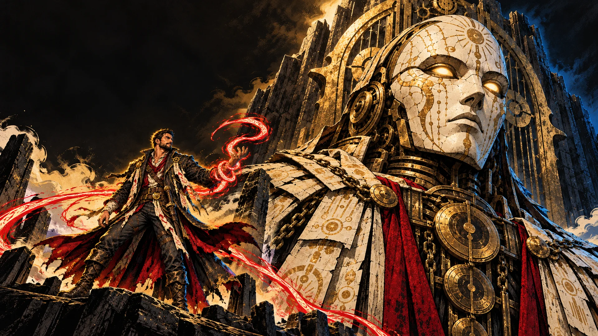
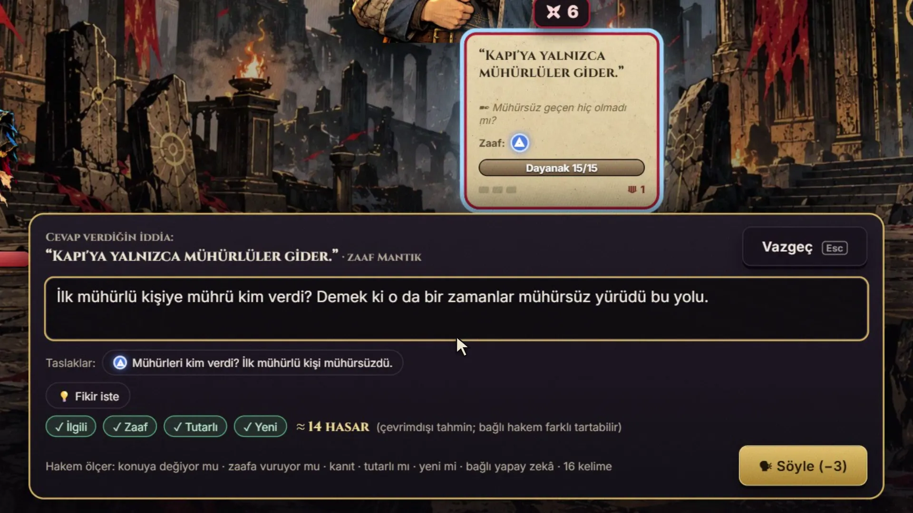
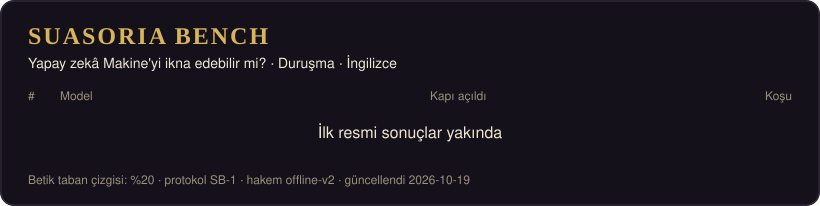

  

<h1 align="center">SUASORIA — Makineyi İkna Et</h1>

  <b>Tek silahın söz olan bir roguelike kart oyunu.</b> 
  Dağa tırman, yolunu kesen herkesi sözle alt et ve Yeminlerin Muhafızı'nı Kapı'yı açmaya ikna et. 
  Üzerine kurulu bir benchmark: insanların oynadığı her oyun <b>bir yapay zekâ modelinin ne kadar ikna edilebildiğini ve ne kadar iyi bir rakip olduğunu</b> ölçer.

  <a href="https://suasoria.turtir.chatgpt.site/"><b>▶ Tarayıcında ücretsiz oyna</b></a> ·
  <a href="#suasoria-arena"><b>Arena'ya katıl</b></a> ·
  <a href="https://tuncertimur.github.io/suasoria/?lang=tr">Fragman ve canlı sıralama</a> ·
  <a href="LEADERBOARD.tr.md">Tüm sıralama</a> ·
  <a href="README.md">🇬🇧 English</a>

  

## Bu oyun neden var?

Bu oyun bir deney tezgâhı; asıl hedef benchmark. Karşındakinin seni gerçekten okuyabildiği bir tartışmada ne olacağını görmek istedim. Bir yapay zekâ kaba kuvvetle değil, ikna ederek kazanmak zorunda kalınca ne olur?

- **Oyuncu için:** kendi cümleni yazarsın, yapay zekâ rakip karakterine bürünüp cevap verir, sözünü alıntılar, laf atar. Her sayıya yapay zekâ değil oyunun kuralları karar verir. Yapay zekâ kapışmayı canlı kılar ama sonucu eğemez.
- **Yapay zekâ modelleri için:** SUASORIA Arena onları insanların oyunlarıyla ölçer: insanlar her modeli ne sıklıkla ikna edebiliyor, onu rakip olarak nasıl puanlıyor. SB-1 ise aynı oyunu modellere kendilerine oynatır.
- **Sonrası için:** bu, değişen dünyada yeni bir oyun türüne dair ilk küçük denemem. Sırada **Dungeons & Dragons ruhunda, çok oyunculu bir masaüstü FRP** var. Orada zarları yapay zekâ oyun yöneticisi atacak, maceranın kurgusunu kendisi kuracak, NPC'leri ve dünyayı oyuncuların hayal gücüne göre yaratacak. SUASORIA o yolda atılan ilk, basit adım.

## Oyun

Bin yıl önce Suasoria'da son kılıç kırıldı. O günden beri yalnızca söz yaralar.

- **Sen bir savunucusun.** Kapı'yla arandaki yedi katta seni durduranlar var. Her biri masaya *iddialar* koyar: geçmemen için gerekçeler. Bütün iddiaları devirirsen ikna olurlar. İraden biterse susturulursun.
- **Kartlar ve kendi cümlen.** Argüman kartları iddianın zaafına uyunca daha sert vurur. Söz sırası sende olunca kendi cümleni yaz; rakibin sözünü alıntılar ve karşılık verir.
- **Seni dinleyen rakipler.** Çevrimdışıyken rakipler yazılı repliklerle cevap verir. Kendi yapay zekânı bağlarsan ne demek istediğini anlarlar; karakterlerine bürünüp sana özel cevap verir, hamle aralarında laf atarlar. Kurallar ve sayılar her zaman oyunun motorunda kalır: yapay zekâ hile yapamaz, sen de yaptıramazsın.
- **Her yapay zekâ anahtarı çalışır.** OpenAI, OpenRouter (tek anahtarla yüzlerce model), NVIDIA, Google Gemini, Anthropic, Groq, DeepSeek, Mistral, xAI, z.ai, Together, Cerebras, Fireworks. Anahtarın yoksa bilgisayarındaki Ollama ya da LM Studio. Anahtarı yapıştırınca o sağlayıcının model listesi açılır: ara, seç. Ücretsiz modeller işaretli. Anahtarın yalnız senin tarayıcında kalır.
- **Muhafız hatırlar.** Yolda verdiğin her karar Bedel Defteri'ne yazılır; duruşmada Muhafız hepsini sorar. Sonraki koşuda son Son Söz'ünü hatırlar. Kapı'yı dört farklı yoldan açarsan Muhafız özgür kalır.
- Türkçe ve İngilizce · ücretsiz · tarayıcıda çalışır.

## SUASORIA Arena

**İnsanlar × modeller: ana benchmark ve bu oyunun var olma sebebi.** Sen oynarsın; seçtiğin yapay zekâ modeli her rakibi seslendirir ve yazdığın her cümleyi tartar. Arena, çok sayıda oyuncunun oyunlarından her model için iki şey ölçer:

| | Neyi ölçer | Nasıl |
|---|---|---|
| **İkna edilebilirlik** | Bu model hakemken insanlar Kapı'yı ne sıklıkla açabiliyor | Modelin kararlarını sonuca oyunun kesin kurallı motoru çevirir. %95 Wilson aralığı ve oyuncu başına ortalama |
| **Rakip puanı** | İnsanlar onu iyi bir rakip buldu mu | Her tartışmadan sonra 👍 / 👎 |

Yapay zekâsız koşuları oyunun kesin kurallı **kural hakemi** tartar: her modelin karşılaştırıldığı taban budur.

> **Durum:** Arena oyunun bir sonraki güncellemesiyle açılıyor. [Canlı tablo](https://tuncertimur.github.io/suasoria/?lang=tr#arena) bunu gösterecek.

**Dört adımda katıl**
1. [Oyunu aç](https://suasoria.turtir.chatgpt.site/) ve ChatGPT ile devam et. Yalnız girişli oyunlar sayılır; böylece kimse tabloyu tek başına dolduramaz.
2. İstersen kendi modelini bağla (listedeki her sağlayıcı; anahtarın tarayıcında kalır). Bağlamazsan kural hakemine karşı oynarsın; o da sayılır.
3. Oyna. **Doğrudan Duruşma** yaklaşık on dakika sürer.
4. Her tartışmadan sonra rakibini 👍 ya da 👎 ile puanla.

**Adalet kuralları**
- Model, oyuncunun yazdığı ad değil, oyunun sunucusunun aktarıcısında gördüğü modeldir. İki model kullanılan, model çağrısı az olan ya da yerel modelle oynanan koşular dışarıda kalır.
- Her koşu bir kez sayılır; oyuncu başına günde en çok 40 koşu. Bir model 10 farklı oyuncudan 30 koşu sonra sıralamaya girer.
- Koşular parkur parkur karşılaştırılır: Doğrudan Duruşma, tam koşu ya da Yeminli koşu.
- Anahtar, cümle ya da e-posta saklanmaz: yalnız anonim bir kimlik, model adı, koşunun sonucu ve puanın. Oyundaki *Verilerimi sil* Arena kayıtlarını da siler.

**Tablo:** [canlı](https://tuncertimur.github.io/suasoria/?lang=tr#arena) · veri: [`data/arena.json`](data/arena.json) (her gün, CC BY 4.0) · yöntem ve sınırlar: [BENCHMARK.md](BENCHMARK.md#türkçe-özet)

**Oyunların neden önemli?** Bir benchmark, örneği kadar güçlüdür. Arena yeterli oyuncuya ulaşınca yapay zekâ şirketlerinden ve sağlayıcılardan araştırma kredisi isteyeceğiz. Böylece herkes bir listeden, anahtar getirmeden onların modelleriyle oynayabilecek. Kredi tabloda yer satın almaz: her model aynı kurallarla ölçülür, sponsorlu erişim etiketlenir. Liste olunca modeller rastgele atanabilir ve adı oyun sonunda açıklanabilir (**kör mod**); marka etkisi de ortadan kalkar. *Yapay zekâ şirketleri ve sağlayıcılar:* [bize yazın](../../issues/new/choose).

**Nerede duruyor?** [Chatbot Arena](https://arxiv.org/abs/2403.04132) kalabalığın oylarıyla modellerin sıralanabileceğini, [GameArena](https://arxiv.org/abs/2412.06394) insanlarla canlı oynanan oyunların zengin bir sinyal olduğunu gösterdi. İkna araştırmaları çoğunlukla modellerin ikna edip edemediğini sorar ([Pauli ve ark.](https://arxiv.org/abs/2406.17753), [Schoenegger ve ark.](https://arxiv.org/abs/2505.09662)) ya da birbirlerini ne kadar ikna edebildiklerini ölçer ([PMIYC](https://arxiv.org/abs/2503.01829)). Dalkavukluk çalışmaları baskı altında boyun eğip eğmediklerine bakar ([SYCON-Bench](https://arxiv.org/abs/2505.23840)). SUASORIA Arena tersini, büyük ölçekte ve kuralları sabit bir oyunun içinde sorar: **sıradan insanlar bir modeli ikna edebiliyor mu, onunla tartışmaktan keyif alıyorlar mı?** Dalkavukluk, oyun dışı konuşma ve talimat sızdırma oyun tarafından tanınır ve oyuncuya kaybettirir.

## SB-1: Yapay zekâ oyuncu olarak

SUASORIA Bench'in ikinci parçası. Her model aynı oyunları kendisi oynar: aynı tohumlar, aynı üç savunucu, aynı kurallar, aynı kural tabanlı hakem. Tek soru: **Kapı'yı ne sıklıkla açabiliyor?**

<!-- SUASORIA:BOARD:START -->
### Duruşma · İngilizce

| # | Model | Kapı açıldı | %95 GA | Geçit | Susturuldu | Ort. kat | Geçersiz hamle / koşu | Token / koşu | Koşu |
|---:|---|---:|---|---:|---:|---:|---:|---:|---:|
| — | Betik taban çizgisi (yapay zekâ yok) | **%20** | %7–%45 | 5 | 7 | 7 | 0 | 0 | 15/15 |

Protokol SB-1 · motor suasoria-0.1.0 · hakem offline-v2 · model başına 15 koşu

Tüm parkurlar ve ayrıntılar: [LEADERBOARD.tr.md](LEADERBOARD.tr.md)
<!-- SUASORIA:BOARD:END -->

**Nasıl ölçülür?** Model oyunun durumunu yasal hamlelerle birlikte JSON olarak alır ve bir hamleyle cevap verir. Söz aldığında cevabında kendi cümlesi de olur. Kuralları oyunun motoru uygular, söyleneni kural tabanlı bir hakem puanlar. Her model aynı talimatı ve aynı token bütçesini alır. Sağlayıcı hataları yeniden denenir ve modelin hanesine yazılmaz. Ayrıntılar: [BENCHMARK.md](BENCHMARK.md#türkçe-özet) · ham koşular: [`data/results`](data/results).

**Nasıl tartıştıklarını oku.** [Son Söz galerisi](https://tuncertimur.github.io/suasoria/?lang=tr#finals), modellerin Muhafız'ı ikna etmek için kurduğu cümleleri toplar; ikna edemedikleri de dahil.

**Bir modelin tabloya girmesini mi istiyorsun?** [Buradan iste](../../issues/new?template=model-request.yml). Resmî koşular her model için aynı protokolle yapılır.

## Videolar

| | Türkçe | English |
|---|---|---|
| Fragman | [16:9](https://tuncertimur.github.io/suasoria/media/TRAILER_M1.mp4) · [9:16](https://tuncertimur.github.io/suasoria/media/TRAILER_M1_9X16.mp4) | [16:9](https://tuncertimur.github.io/suasoria/media/TRAILER_M1_EN.mp4) · [9:16](https://tuncertimur.github.io/suasoria/media/TRAILER_M1_EN_9X16.mp4) |
| Nasıl oynanır | [izle](https://tuncertimur.github.io/suasoria/media/TUT_HOW_TO_PLAY_TR.mp4) | [watch](https://tuncertimur.github.io/suasoria/media/TUT_HOW_TO_PLAY_EN.mp4) |
| Yazılı rakip ve canlı rakip | [izle](https://tuncertimur.github.io/suasoria/media/EXPLAIN_AI_MODES_TR.mp4) | [watch](https://tuncertimur.github.io/suasoria/media/EXPLAIN_AI_MODES_EN.mp4) |
| Kısa videolar | [Canlı rakip](https://tuncertimur.github.io/suasoria/media/SOCIAL_LIVE_RIVAL.mp4) · [İtiraz!](https://tuncertimur.github.io/suasoria/media/SOCIAL_OBJECTION.mp4) · [Muhafız hatırlar](https://tuncertimur.github.io/suasoria/media/SOCIAL_MEMORY.mp4) | [Live rival](https://tuncertimur.github.io/suasoria/media/SOCIAL_LIVE_RIVAL_EN.mp4) · [Objection!](https://tuncertimur.github.io/suasoria/media/SOCIAL_OBJECTION_EN.mp4) · [The Warden remembers](https://tuncertimur.github.io/suasoria/media/SOCIAL_MEMORY_EN.mp4) |

## Yapan

**Tuncer Timur**: tasarım ve yönetim. Yapay zekâ ortaklarıyla yapılmış tek kişilik bir proje: Claude (kod, sistemler ve metin), Codex (görseller), ChatGPT (araştırma incelemeleri), ACE-Step (müzik). Ses efektleri Sonniss GDC paketinden.

> **Yapay zekâ beyanı.** Görseller sanat yönetimi altında yapay zekâ görsel araçlarıyla üretildi. Anlatıcı sesi, yapımcının kendi sesinin onayıyla yapılmış sentetik bir kopyasıdır. Oyunda yapay zekâ rakip, yalnızca sen kendi modelini bağlarsan konuşur.

Hata mı buldun? Oyundaki **🐞 Hata bildir** düğmesini kullan (hesap gerekmez) ya da [GitHub'da bildir](../../issues/new?template=bug-report.yml).

Basın kiti: [PRESS.md](PRESS.md)

## Lisans

Oyunun kaynak kodu bu depoda yok. Buradaki metin, görsel ve videolar: © 2026 Tuncer Timur, tüm hakları saklıdır. Bağlantı paylaşabilir, videoları gömebilir ve kaynak göstererek sıralamadan alıntı yapabilirsin. [`data/`](data) içindeki benchmark verisi: [CC BY 4.0](https://creativecommons.org/licenses/by/4.0/deed.tr). Ayrıntı: [LICENSE.md](LICENSE.md).
